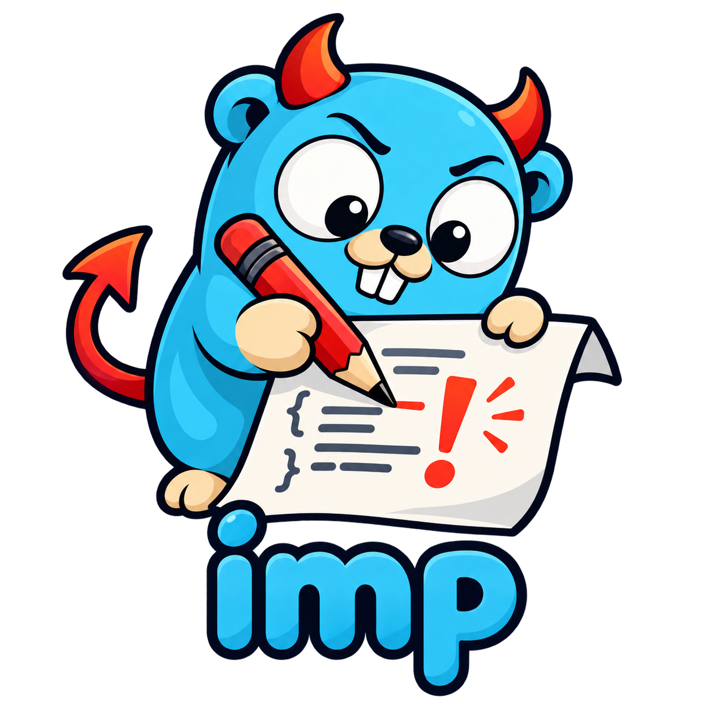

# imp

[](https://github.com/smedijan/go-imp/actions/workflows/ci.yml)

<p align="center">
  
</p>

`imp` is a mutation-testing tool for Go that helps developers—and coding agents—write more testable code and stronger tests. It introduces small, realistic changes to your code and reports which ones your test suite catches.

## Install

Requires Go. Until the first `imp` release, install the main branch with:

```sh
go install github.com/smedijan/go-imp/cmd/imp@main
```

Then run it from a Go module:

```sh
imp run
```

See [the installation guide](docs/docs/install.md) and [usage documentation](docs/docs/index.md).

## License

The source code is licensed under [Apache-2.0](LICENSE). Carried-over documentation remains under [CC BY-SA 4.0](http://creativecommons.org/licenses/by-sa/4.0/).

---

`imp` is an independent continuation of [go-gremlins/gremlins](https://github.com/go-gremlins/gremlins), with its Git history preserved.
